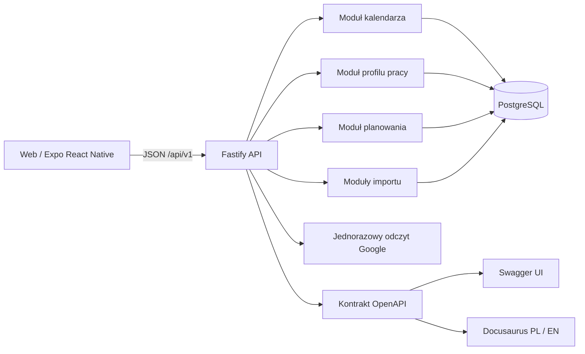

# Architektura

## Główne komponenty

## Backend modułowy

Wszystkie zasoby HTTP należą do jednej domeny API i wspólnej wersji `/api/v1`. Trasy są jednak rozdzielone według odpowiedzialności:

- `src/api/v1/calendar/routes.ts` obsługuje przegląd kalendarza oraz wydarzenia.
- `src/api/v1/profile/routes.ts` obsługuje profil pracy: limity godzin, cel godzin (tydzień albo miesiąc), dojazd, dostępność, preferencje, blokady i szablony zmian. Zapis jest atomowy i wymaga aktualnej wersji profilu (optimistic locking).
- `src/api/v1/scheduling/routes.ts` obsługuje generowanie, edycję, walidację, akceptację i historię grafików.
- `src/api/scope.ts` ustala użytkownika żądania po stronie serwera. Do czasu logowania jest to użytkownik demonstracyjny z konfiguracji.
- `src/api/v1/imports/routes.ts` obsługuje podgląd importu, sesje oraz odczyt plików i planów zajęć.
- `src/api/v1/imports/google-routes.ts` implementuje jednorazowy import Google jako adapter źródła danych.
- `src/api/v1/health/routes.ts` zawiera sondy liveness i readiness.
- `src/api/contracts.ts` zawiera kontrakty zależności repozytoriów przekazywanych trasom.

Moduł tras otrzymuje zależności przez opcje Fastify. Nie otwiera własnego połączenia z bazą i nie importuje modułów innej domeny po implementację. Logikę domenową i SQL przechowują odpowiednie moduły repozytorium.

## Przepływ żądania

1. Fastify dopasowuje trasę w `/api/v1`.
2. JSON Schema sprawdza parametry, query string i body przed wywołaniem handlera.
3. Handler koordynuje przypadek użycia domeny.
4. Repozytorium wykonuje odczyt lub transakcję w PostgreSQL.
5. OpenAPI jest generowane z tych samych schematów walidacji, które działają w runtime.

## Wersjonowanie

`/api/v1` jest wersją kontraktu, a nie nazwą domeny. Nowe funkcje dodawaj jako zasoby w tej wersji, np. `/api/v1/calendar/events`, `/api/v1/schedules` i `/api/v1/import/sessions`. Zmiany niekompatybilne wymagają nowej przestrzeni `/api/v2`; nie modyfikuj po cichu zachowania istniejącej wersji.

## Zasady danych

- Importy są najpierw propozycją/sesją. Kalendarz zmienia się dopiero po walidacji i potwierdzeniu.
- Akceptacja grafiku ponownie sprawdza ograniczenia w backendzie i zapisuje zmiany wraz z wydarzeniami w transakcji.
- Czas wydarzeń jest interpretowany w strefie czasowej profilu użytkownika.
- Użytkownik ma najwyżej jeden aktywny profil pracy (unikalny indeks w bazie). Cel miesięczny jest przeliczany na tydzień (miesiąc = 52/12 tygodnia) i ta wartość trafia do generatora. Zmiana profilu wpływa tylko na kolejne generowane grafiki.
- Konflikty kalendarza oraz wersje grafiku są rozstrzygane w backendzie, nie tylko w UI.
