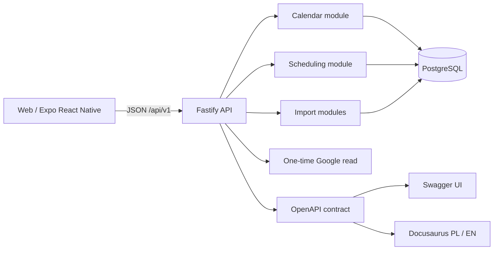

# Architecture

## Main components

## Modular backend

All HTTP resources belong to one API domain and the shared `/api/v1` version. Routes are split by responsibility:

- `src/api/v1/calendar/routes.ts` handles calendar overview and events.
- `src/api/v1/scheduling/routes.ts` handles profile settings, generation, editing, validation, approval and schedule history.
- `src/api/v1/imports/routes.ts` handles import previews, sessions, file readers and class schedules.
- `src/api/v1/imports/google-routes.ts` implements one-time Google import as a data-source adapter.
- `src/api/v1/health/routes.ts` contains liveness and readiness probes.
- `src/api/contracts.ts` defines repository dependencies passed to route modules.

Route modules receive dependencies through Fastify plugin options. They do not open database connections or import another domain's implementation. Domain logic and SQL live in their respective services and repositories.

## Request flow

1. Fastify matches a route under `/api/v1`.
2. JSON Schema validates parameters, query string and body before the handler runs.
3. The handler coordinates the domain use case.
4. A repository performs reads or a PostgreSQL transaction.
5. OpenAPI is generated from the same schemas used for runtime validation.

## Versioning

`/api/v1` is the contract version, not a domain name. Add features as resources in this version, for example `/api/v1/calendar/events`, `/api/v1/schedules` and `/api/v1/import/sessions`. Breaking changes require a new `/api/v2` namespace; do not silently change existing behavior.

## Data rules

- Imports are staged as proposals/sessions. The calendar changes only after validation and confirmation.
- Schedule approval rechecks constraints on the server and commits shifts with calendar events in a transaction.
- Event times are interpreted in the user's profile timezone.
- Calendar conflicts and schedule versions are resolved by the backend, not only by the UI.
